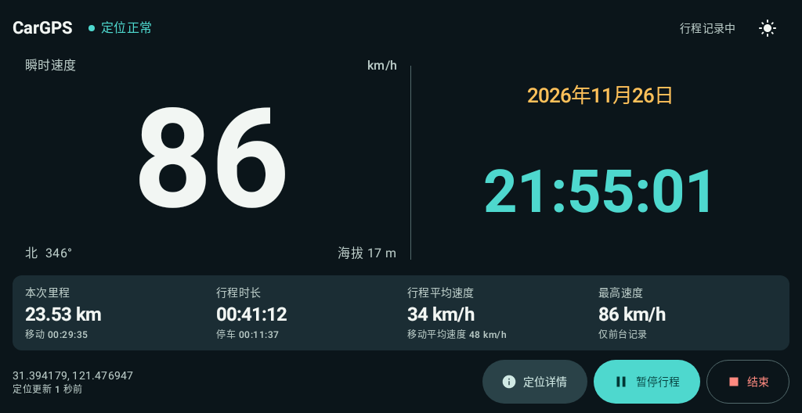

# GPS

面向 Android 车机的离线速度与行程仪表，为 **1024×600 横屏、Android 8.1** 设计。主屏突出瞬时速度和时分秒，日期独立分色，行程数据集中显示，方便一眼读取。

使用车机自带的 GPS / 北斗定位能力，无需账号、地图服务或 Google Play Services。本仓库只维护车机应用。

[下载正式版](https://github.com/lonnnnnng/cargps/releases/latest) · [版本说明](docs/release-notes-v0.1.4.md) · [开发文档](docs/README.md)

## 界面预览



> 夜间模式效果图，使用示例数据。图片中的 `CarGPS` 是更名前的名称，当前应用名称为 `GPS`；预览内容区为 1024×528。

瞬时速度使用最大字号；时分秒以青色突出显示，年月日以琥珀色单独呈现。主屏保留方向、海拔、经纬度与定位更新时间，卫星数量和诊断指标收在「定位详情」中。支持日间与夜间模式切换。

## 下载与安装

当前正式版为 **v0.1.4**，APK 大小约 **0.87 MiB**，使用正式发布证书签名。

| 文件 | 用途 |
| --- | --- |
| [GPS-Car-v0.1.4.apk](https://github.com/lonnnnnng/cargps/releases/download/v0.1.4/GPS-Car-v0.1.4.apk) | 车机安装包 |
| [SHA256SUMS](https://github.com/lonnnnnng/cargps/releases/download/v0.1.4/SHA256SUMS) | 下载文件的 SHA-256 校验值 |
| [GPS-Release-Certificate.pem](https://github.com/lonnnnnng/cargps/releases/download/v0.1.4/GPS-Release-Certificate.pem) | 公开签名证书 |

将 APK 复制到车机，通过文件管理器安装。首次打开时授予定位权限，并开启系统定位开关；卫星定位需要车机具有相应的 GNSS 硬件和天线。

| 项目 | 要求或说明 |
| --- | --- |
| Android 版本 | 8.1（API 27）及以上 |
| 目标屏幕 | 1024×600，横屏；以 CASKA 车机、160 dpi 为适配基准 |
| 卫星系统 | GPS / 北斗，实际支持范围取决于车机硬件和系统驱动 |
| 网络 | 使用时无需联网 |
| 应用名称 / 包名 | `GPS` / `com.lonng.cargps` |

## 主要功能

| 功能 | 说明 |
| --- | --- |
| 速度仪表 | 瞬时速度、行程平均速度、移动平均速度、最高速度 |
| 日期与时钟 | 显示到秒，年月日独立排版，按车机系统时间与时区显示 |
| 行程记录 | 开始、暂停、继续、结束；结束前确认，减少误触 |
| 行程统计 | 本次里程、总时长、移动时长、停车时长 |
| 定位信息 | 经纬度、海拔、方向、定位状态、精度与更新时间 |
| 定位详情 | GPS / 北斗可见与参与定位数量，以及 HDOP、PDOP、VDOP、NMEA 诊断信息；可用数据以设备上报为准 |
| 本地保存 | 使用 SQLite 保存行程，进程重启后可恢复未结束的行程 |

指标保留常用写法，如 GPS、北斗、HDOP、PDOP、VDOP；速度、距离和海拔使用 `km/h`、`km`、`m`。

## 使用方法

1. 打开应用，确认定位权限已授予、系统定位已开启，等待定位状态正常。
2. 点击「开始行程」，开始累计本次里程、时间与速度统计。
3. 需要中断记录时点击「暂停行程」，返回后继续；点击「定位详情」查看卫星与定位质量。
4. 行程完成后点击「结束」并确认，保存本次记录。

**当前仅在应用处于前台时采集和记录定位。** 切换到其他应用或进入后台后会停止采集，返回后继续；暂停、定位中断和后台切换处会划分路段，避免把中断期间的位移直接连成有效里程。

行程数据保存在车机本地，应用不申请网络权限，也不会上传位置。当前版本尚未提供历史行程浏览、轨迹导出、地图导航或后台持续记录功能。

## 开发与构建

项目使用 **Kotlin + Jetpack Compose**，通过 Android 系统 `LocationManager` 获取定位、GNSS 卫星状态和 NMEA 数据，使用 SQLite 持久化行程。统计采用增量计算，界面只在可见时按秒刷新。

### 工程结构

所有源码和测试集中在唯一的 `app` 模块中：

```text
cargps/
├── app/
│   ├── build.gradle.kts
│   └── src/
│       ├── main/
│       │   ├── AndroidManifest.xml
│       │   ├── java/com/lonng/cargps/
│       │   │   ├── MainActivity.kt
│       │   │   ├── DashboardViewModel.kt
│       │   │   ├── LocationEngine.kt
│       │   │   ├── ui/          # 仪表界面与主题
│       │   │   ├── domain/      # 定位质量、NMEA 与行程统计
│       │   │   └── storage/     # 本地行程存储
│       │   └── res/
│       ├── test/               # 本地单元测试与离线界面测试
│       └── androidTest/        # 设备仪器测试
├── docs/                       # 产品、技术、发布文档与展示图片
├── gradle/wrapper/
├── gradlew
└── settings.gradle.kts
```

### 环境准备

- JDK 17。
- Android SDK Platform 34，`compileSdk` / `targetSdk` 均为 34，`minSdk` 为 27。
- 使用仓库内的 Gradle Wrapper（8.7），无需单独安装 Gradle。
- 在本机 `local.properties` 中配置 `sdk.dir`，或设置 `ANDROID_HOME`；本机路径不提交到仓库。首次构建需要联网下载依赖。

### 调试与验证

在仓库根目录执行：

```zsh
./gradlew :app:testDebugUnitTest
./gradlew :app:compileDebugAndroidTestKotlin
./gradlew :app:lintDebug :app:assembleDebug
```

调试 APK 输出至 `app/build/outputs/apk/debug/app-debug.apk`。`compileDebugAndroidTestKotlin` 只编译仪器测试代码，不代表测试已在设备上运行。

### 正式版构建

按照[正式签名说明](docs/release-signing.md)配置签名环境后执行：

```zsh
./gradlew :app:lintRelease :app:assembleRelease
```

正式 APK 输出至 `app/build/outputs/apk/release/app-release.apk`。Release 启用 R8 代码优化与资源压缩；发布时应在本地归档 `app/build/outputs/mapping/release/`，用于还原对应版本的崩溃堆栈。签名私钥、口令和混淆映射不作为公开附件。

v0.1.4 已通过 40 项本地回归测试、Release 构建、Lint 和签名校验；本地测试不执行 R8 压缩后的 APK，压缩版仍需真实车机验证定位与道路表现。详细范围见[版本说明](docs/release-notes-v0.1.4.md)。

## 项目文档

- [产品规格](docs/product-spec.md)：功能范围、交互与验收标准。
- [技术设计](docs/technical-design.md)：定位数据流、统计与持久化。
- [界面规则](DESIGN.md)：布局、字号与颜色规范。
- [领域词汇](CONTEXT.md)：行程与定位指标的统一定义。
- [定位方案决策](docs/adr/0001-use-platform-locationmanager.md)：选择系统 `LocationManager` 的原因。
- [界面改造与验证记录](docs/ui-redesign-20261126.md)：本次车机适配的实现与验证范围。
- [完整文档索引](docs/README.md)：版本记录、签名说明及其他资料。
