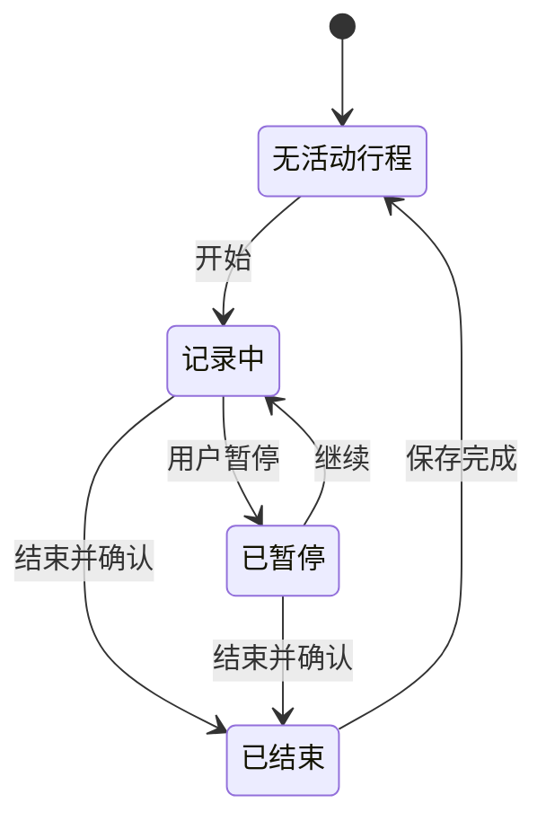

# CarGPS 产品规格

作者：long  
适用设备：CASKA Android 8.1 / API 27 / 1024×600 / 160 dpi

## 1. 产品定位

CarGPS 是车机前台常驻的离线 GPS 仪表，用于清晰显示当前驾驶状态并保存可追溯的行程统计。它不是车辆原厂仪表、法定计量设备或导航软件，GPS 失锁、隧道、多路径反射和海拔模型误差都可能导致读数偏差。

首版必须做到：驾驶中一眼看懂、定位异常不显示假实时数据、统计口径可解释、无网络仍可完整使用。

## 2. 信息架构

### 2.1 主仪表

驾驶中默认停留的页面，只展示高频信息：

- 瞬时速度与单位 `km/h`。
- 定位状态、定位精度、卫星使用数、最近更新时间。
- 当前时间和日期。
- 行程里程、行程平均速度、移动平均速度、最高速度。
- 行程总时长、移动时长、停车时长。
- 海拔、方向和经纬度摘要。
- 开始/暂停/继续、结束行程、日夜模式三个主要操作入口。

### 2.2 定位详情

停车查看的诊断页面：

- 十进制度经纬度，可复制；后续可增加度分秒格式切换。
- 海拔、航向、定位精度、样本时间和样本年龄。
- 可见卫星数、参与定位卫星数、各星座分布。
- 定位类型、PDOP/HDOP/VDOP（设备提供时显示）。
- 最近收到的 NMEA 语句类型、校验状态和原始报文开关。
- 明确区分“设备未提供”和数值 `0`，禁止用 `0` 代替缺失值。

### 2.3 行程历史

- 按开始时间倒序展示已结束行程。
- 每条记录包含开始/结束时间、里程、总时长、移动时长、两种平均速度和最高速度。
- 可查看轨迹摘要、删除单条记录、导出 GPX/CSV。
- 删除属于明确的二次确认操作；首版不提供批量清理。

### 2.4 设置

- 日间、夜间、跟随时间三种主题模式。
- 公制单位为首版固定单位，英制作为后续能力。
- 速度平滑强度、停车判定阈值和自动开始属于高级设置，默认值应能直接使用。
- 可选择是否保存原始 NMEA；默认关闭，避免长期产生大量数据。

## 3. 1024×600 主屏布局

系统状态栏和导航栏存在时，可稳定使用的内容区域约为 1024×528。布局不依赖隐藏系统栏，避免不同车机固件下出现不可操作区域。

```text
┌ GPS 已定位 · 12/18 星 · ±4 m        2026-08-05 11:26 ┐
│                                                        │
│                  86                                    │
│                 km/h                 本次  18.6 km      │
│                 东南 128°            总时长 00:32:18    │
│                                        移动 00:28:40    │
│  行程平均 34.5   移动平均 38.9   最高 112.0 km/h        │
│  海拔 43 m       23.123456, 113.123456       更新 0.4 s │
│  [开始/暂停/继续]             [结束行程]       [详情]    │
└────────────────────────────────────────────────────────┘
```

交互约束：

- 瞬时速度是视觉中心，字号显著大于其他指标。
- 可点击目标不小于 56 dp，主要操作不超过三个。
- 结束行程采用长按或二次确认，避免颠簸误触。
- 驾驶主屏不滚动、不弹出营销内容、不使用持续闪烁动画。
- 夜间主题以纯深色背景和低眩光强调色为主，错误状态不依赖颜色单独表达。

## 4. 定位状态机

| 状态 | 触发条件 | 主屏行为 |
| --- | --- | --- |
| 未授权 | 未获得精确位置权限 | 不显示旧数据，提供授权入口 |
| 定位关闭 | 系统 GPS Provider 未启用 | 提示开启系统定位 |
| 搜星中 | 已监听但尚无有效定位样本 | 速度显示 `--`，显示已等待时长 |
| 已定位 | 样本新鲜且质量满足显示要求 | 正常显示并参与统计 |
| 精度较差 | 有新样本但精度不足 | 可显示带警告的速度，暂停距离累计 |
| 定位过期 | 有效样本超过 3 秒未更新 | 冻结统计，速度先灰显后归零 |
| 定位丢失 | 超过 10 秒没有有效样本 | 速度显示 `--`，不继续累计里程 |

状态恢复后不得用失锁前后两个点直接补一条跨越距离，防止隧道或休眠后出现“瞬移里程”。

## 5. 统计口径

### 5.1 瞬时速度

1. 优先采用系统定位样本提供的速度。
2. 系统未提供速度时，才用相邻有效定位样本的距离和时间推导。
3. 对速度使用短窗口平滑，初始建议为指数平滑 `alpha = 0.35`；平滑不得掩盖停车，连续 2 秒低于停车阈值时应快速归零。
4. 不满足时间顺序、坐标范围或合理运动边界的样本不得刷新主速度和最高速度。

### 5.2 里程

- 只累加相邻有效定位样本之间的地表距离。
- 定位精度差于 30 m、样本间隔超过 10 秒或发生定位过期恢复时，默认不连接这两个点。
- 漂移抑制不能简单丢弃所有低速点；停车状态需要结合速度、位移、精度和持续时间判断。

### 5.3 移动与停车

- 初始移动阈值：速度持续 3 秒达到或超过 2 km/h。
- 初始停车阈值：速度持续 10 秒低于 2 km/h，且位移未明显超过定位误差。
- 用户主动暂停期间不累计里程、移动时长或停车时长。
- 行程平均速度 = 有效里程 / 行程总时长。
- 移动平均速度 = 有效里程 / 移动时长。
- 两种平均速度必须同时命名显示，禁止只写含义不明的“平均速度”。

这些阈值是首版校准起点，不是车辆物理常量；道路实测后再调整。

## 6. NMEA 补充指标

首版解析以下语句，未知语句安全忽略并可计数：

| 语句 | 用途 |
| --- | --- |
| GGA | 定位质量、卫星数、HDOP、海拔 |
| RMC | 有效状态、UTC 日期时间、位置、地速、航向 |
| VTG | 地面航向和地速的交叉核验 |
| GSA | 定位维度、参与定位卫星、PDOP/HDOP/VDOP |
| GSV | 可见卫星及信噪比 |
| ZDA | GNSS UTC 日期时间，设备提供时使用 |

每条 NMEA 语句先验证格式与校验和。NMEA 主要用于诊断和补充字段；主速度、主坐标和行程累计仍以系统 `Location` 样本为统一数据源，避免两套时序独立驱动统计。

## 7. 行程生命周期



- 同一时间只允许一个活动行程。
- 活动行程应定期保存进度，应用异常退出后可以恢复，并明确提示“已恢复上次行程”。
- 自动开始、自动结束和点火状态联动不进入 MVP；没有 OBD/CAN 信号时不能把它们包装成可靠能力。

## 8. 数据与隐私

- 默认仅保存在本机，不需要账号、不上传轨迹、不申请网络权限。
- 权限只在用户进入需要定位的核心功能时请求，并解释用途。
- 原始 NMEA 默认不持久化；用户开启时展示容量影响，并支持按行程导出。
- 导出内容必须由用户主动触发，文件名带行程开始时间，避免覆盖旧文件。

## 9. 版本范围

### MVP

- 权限和定位状态机。
- 主仪表全部实时字段。
- 手动行程生命周期与核心统计。
- 本地行程历史。
- 日间/夜间主题。
- NMEA 基础解析与卫星/精度详情。
- 模拟器路线回放测试和断点恢复测试。

### 后续版本

- GPX/CSV/NMEA 导出。
- 超速提醒；无道路限速数据时仅支持用户设置固定阈值。
- 自动开始/结束、停车点和轨迹回放。
- OBD-II/CAN 数据融合。
- 离线地图或在线地图；它们不是码表核心依赖。

## 10. 验收标准

- 在 CASKA 1024×600 上无遮挡、无横向滚动，系统栏存在时主要操作仍可见。
- 未授权、定位关闭、搜星、精度差、过期和恢复状态均有可验证的独立展示。
- 定位过期后不继续显示伪实时速度，不累计跨失锁距离。
- 行程平均速度与移动平均速度能用同一组样本独立复算，结果误差不超过显示精度。
- 应用进程被终止后，活动行程可恢复且不会重复累计最后一段距离。
- NMEA 校验失败不会导致应用崩溃，也不会污染主统计。
- 所有核心能力在断网状态下可用。
